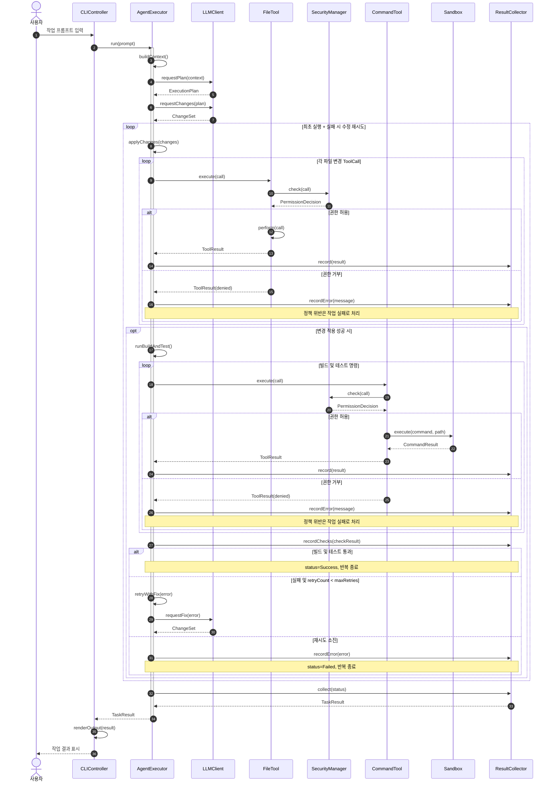
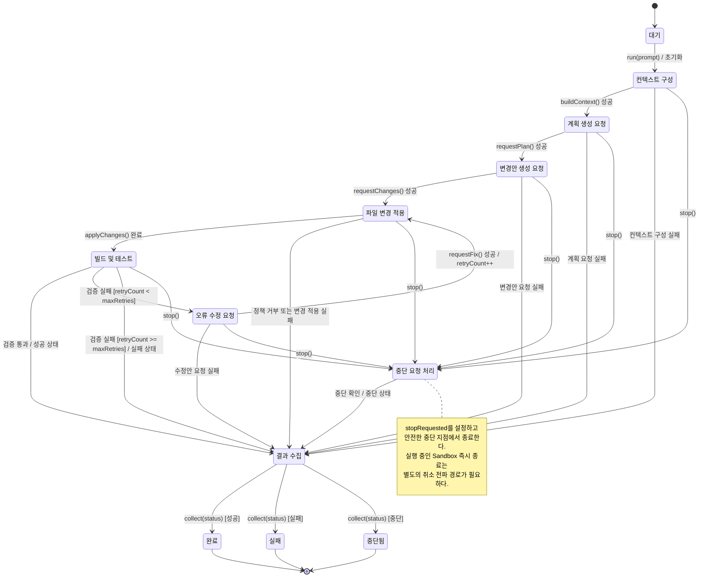

# Coding Agent System 다이어그램

제공된 클래스 다이어그램(CLIController, AgentExecutor, LLMClient, Tool, SecurityManager, ResultCollector, FileTool, CommandTool, Sandbox)에서 도출한 설계안입니다.

## 1. 작업 실행 시퀀스

## 2. AgentExecutor 상태 머신

## 모델 해석 및 보완점

- FileTool.execute / CommandTool.execute는 추상 클래스 Tool.execute를 상속해서 호출하는 것으로 모델링했습니다. perform()은 구체 도구의 구현입니다.
- `TaskStatus`의 실제 enum 항목은 원본 그림에 없어 성공/실패/중단을 개념적 상태로 사용했습니다.
- 시퀀스의 반복 구간은 정상 실행과 자동 수정 재시도를 요약한 것입니다. 권한 거부 시에는 빌드/테스트로 진행하지 않고 실패 결과를 수집하도록 구현해야 합니다.
- 현재 클래스 다이어그램에는 AgentExecutor.stop()에서 실행 중인 CommandTool / Sandbox.terminate()로 중단을 전달하는 명시적 API가 없습니다. 즉시 명령 취소가 필요하면 CommandTool 또는 Tool의 cancel/stop 인터페이스를 설계해야 합니다.
- 중단은 LLM 호출 중에도 요청될 수 있으므로 `stopRequested`의 동시성 안전성과 취소 확인 지점을 구현에서 정의해야 합니다.
